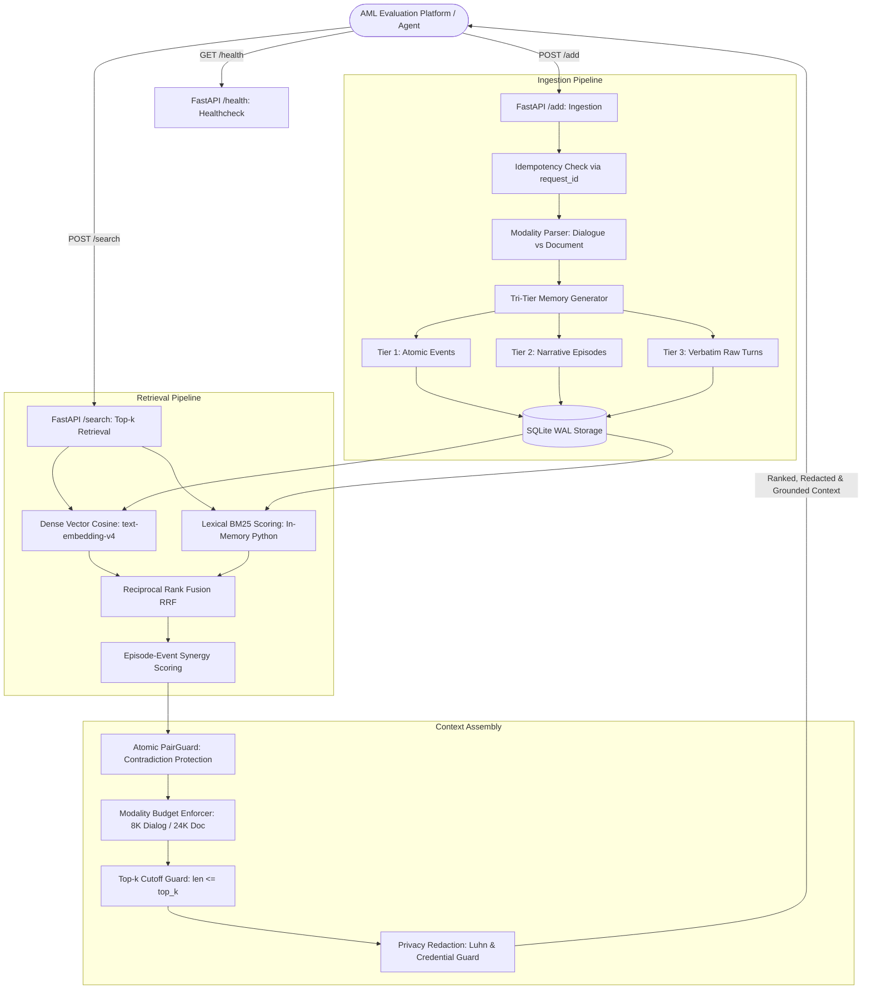

# E²-Mem Evidence Anchor (v2.6.3)

[](https://opensource.org/licenses/MIT)
[](https://www.python.org/downloads/)
[](https://agentmemoryleaderboard.ai/)
[](https://www.docker.com/)
[](tests/)

**E²-Mem Evidence Anchor** is an open-source, high-performance memory service engineered for autonomous AI agents on the **Agent Memory Leaderboard (AML 2026)**.

---

## 📌 Competition Version Declaration

- **Competition Version**: `2.6.3`
- **Competition Tag**: **`v2.6.3-clean`**
- **Service Code Guarantee**: Service code (`service/`) is byte-identical from commit `2e5230b` to the declared commit; later commits update documentation, configuration, and dependencies only. The declared evaluation commit is recorded on the AML platform.
- **Note on Tags**: The repository contains an earlier experimental tag `v2.7-release` (created 2026-10-27) from exploratory offline experiments on verbatim window expansion. It is not part of the active competition deployment. The official submitted and evaluated release is **`v2.6.3-clean`**.

---

## 💡 Method Overview

E²-Mem Evidence Anchor structures conversational and document memory into a multi-tiered hierarchy to balance precision, coherence, and retrieval speed:

1. **Tri-Tier Representation**:
   - **Atomic Events**: Fine-grained factual statements extracted from dialogue turns, timestamped and entity-attributed.
   - **Episodes**: Thematic summaries generated for each extraction chunk (approx. 6–8 messages).
   - **Verbatim Raw Turns**: Unmodified source utterances preserving original quotes, code, and exact phrasing.

2. **Evidence Anchor Retrieval**:
   - Multi-channel candidate scoring combining dense vector similarity (brute-force cosine over user candidates with `text-embedding-v4`) with BM25-style lexical scoring computed in Python over stored candidate rows.
   - Reciprocal Rank Fusion (RRF) and top-down synergy scoring linking events to their parent episodes.
   - Grounded context assembly: retrieved facts are anchored directly to their parent episode and verbatim source snippet, preventing out-of-context misinterpretation.

3. **Temporal Consistency & Atomic PairGuard**:
   - Identifies superseded facts and state transitions across multi-session horizons.
   - Binds contradictory or updated fact pairs atomically so downstream readers observe chronological progression.

4. **Modality-Aware Token Discipline**:
   - Enforces an 8,000-token budget for multi-session dialogue to avoid reader attention dilution, while dynamically expanding up to 24,000 tokens for long-form statutory and regulatory documents.

---

## 🔄 Changes in v2.6.3 (Relative to v2.6.2)

- **Privacy Redaction**: Added pattern-based redaction on `/search` output using Luhn algorithm validation for payment card numbers and context-bounded filters for sensitive credentials (API keys, private keys, secrets). Stored database records remain intact; only rendered search responses are sanitized.
- **Structured Trace Logging**: Added configurable JSONL trace logging for incoming `/add` and `/search` requests, recording timestamps, options payloads, redaction counts, returned items count, and latency metrics for auditability.
- **API Options Field Support**: Added support for the optional `options` list field in the `POST /search` payload for choice-based evaluation benchmarks.

---

## 🏗️ System Architecture



---

## 🔌 API Contract & Endpoints

### 1. `GET /health`
Returns system status and version:
```bash
curl http://localhost:8000/health
```
```json
{"status": "ok", "service": "e2mem-evidence-anchor", "version": "2.6.3"}
```

### 2. `POST /add`
Ingests conversational sessions or document texts with request-level idempotency:
```bash
curl -X POST http://localhost:8000/add \
  -H "Content-Type: application/json" \
  -H "Authorization: Bearer <MEMORY_SYSTEM_KEY>" \
  -d '{
    "request_id": "req_001",
    "user_id": "user_42",
    "session_id": "sess_101",
    "messages": [
      {"role": "user", "content": "I moved to Seattle this month.", "timestamp": "2026-05-01"},
      {"role": "assistant", "content": "Welcome to Seattle! How is your new apartment?", "timestamp": "2026-05-01"}
    ]
  }'
```

### 3. `POST /search`
Retrieves top-k evidence blocks within modality token limits:
```bash
curl -X POST http://localhost:8000/search \
  -H "Content-Type: application/json" \
  -H "Authorization: Bearer <MEMORY_SYSTEM_KEY>" \
  -d '{
    "user_id": "user_42",
    "query": "Where does user_42 live?",
    "top_k": 5
  }'
```

---

## 🚀 Deployment & Quickstart

### Prerequisites
- Python 3.11+
- Docker & Docker Compose (recommended)
- SQLite 3.35+

### Option A: Run with Docker Compose (Recommended)
```bash
cp .env.example .env
# Edit .env with your model API keys
docker compose up -d --build
curl http://localhost:8000/health
```

### Option B: Run Standalone Docker
```bash
docker build -t e2mem-evidence-anchor:v2.6.3-clean .
docker run -d -p 8000:8000 \
  -e PORT=8000 \
  -v $(pwd)/data:/data \
  --name aml-memory \
  e2mem-evidence-anchor:v2.6.3-clean
```

### Option C: Run Locally with Python
```bash
pip install -r requirements.txt
./start_service.sh
```

---

## 🧪 Verification & Unit Tests

The test suite validates contract defense, request idempotency, boundary truncation, and privacy masking:
```bash
pytest tests/ -v
```

All 32 unit tests execute in `< 3.0` seconds:
- `tests/test_aml_smoke.py`: Endpoint compliance, authentication enforcement, and user isolation.
- `tests/test_pair_guard.py`: Contradiction pairing and strict `len <= top_k` boundary safety.
- `tests/test_evidence_anchor.py`: Token budget cutoff protection and source alignment.
- `tests/test_service_core.py`: Ingestion idempotency, extraction, and context sliding.
- `tests/test_privacy_and_trace.py`: Luhn card validation, credential masking, and trace logging.

---

## 📚 References & Prior Work

E²-Mem Evidence Anchor builds upon and references the following research papers, benchmarks, and frameworks:

### Core Research
- **E2-Mem**: *An Episodic-Event Hierarchical Memory Framework for Long-Term Web-Based LLM Agents*. Accepted at **WISE 2026** (to appear in Springer LNCS). [Official Repository](https://github.com/jianminYa/e2mem-aml-public)

### Methodology & Algorithms
- **BM25 Scoring**: S. Robertson, H. Zaragoza, et al. *The Probabilistic Relevance Framework: BM25 and Beyond*, Foundations and Trends in Information Retrieval, 2009.
- **Reciprocal Rank Fusion (RRF)**: G. V. Cormack, C. L. Clarke, and S. Buettcher. *Reciprocal rank fusion outperforms condorcet and individual rank learning methods*, SIGIR 2009.
- **Reranker Note**: An optional external reranker interface (`service/jev_client.py`) is supported in code but is disabled (`ENABLE_JEV=0`) in the official competition deployment.

### Evaluation Benchmarks & Infrastructure
- **FastAPI & Uvicorn**: High-performance asynchronous web framework and ASGI server for Python.
- **SQLite**: Lightweight relational storage operated in WAL mode.
- **CLBench**: Context-learning and procedural compliance benchmark for agent rule adherence.
- **LoCoMo**: Long-Horizon Conversational Memory Benchmark.
- **PersonaMem**: Benchmark for personalized preference tracking and persona consistency.
- **BEAM**: Multi-session long-context synthesis benchmark.
- **LongMemEval**: Standardized conversational long-term memory evaluation.

---

## 📄 License
This repository is licensed under the [MIT License](LICENSE).
