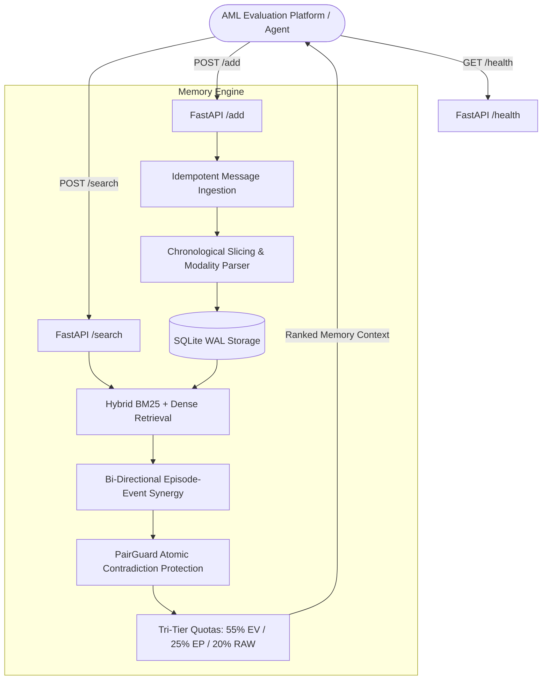

# E²-Mem Evidence Anchor (v2.6)

[](https://opensource.org/licenses/MIT)
[](https://www.python.org/downloads/)
[](https://agentmemoryleaderboard.ai/)

**E²-Mem Evidence Anchor** is a high-performance, open-source long-term memory system optimized for the **Agent Memory Leaderboard (AML)**.

It addresses key failure modes in agentic long-term memory—such as context dilution, temporal fact obsolescence, and lost verbatim detail under tight token budgets—by introducing:
1. **Tri-Tier Channel Quotas** (55% Event / 25% Episode / 20% Raw) for balanced multi-hop coverage and verbatim fidelity.
2. **Intra-Channel PairGuard** for atomic pairing of contradictory or superseded facts, preventing the LLM reader from acting on outdated knowledge.
3. **Adaptive Modality Routing & Chronological Anchoring** for long-context artifacts (e.g. manuals, specification sheets) and multi-session dialogues.
4. **Sub-200ms Search Latency** with zero external heavy rerankers, in-memory caching, and robust single-client HTTP/2 retry logic.

---

## 🏗️ System Architecture



---

## 📊 Verified Benchmark Performance

Evaluated strictly under the **frozen official AML contract** (`gpt-4o-mini` reader, `text-embedding-v4`, context token budget 8,000, official prompts and judges):

| Benchmark Dataset | Questions ($N$) | Official Baseline 1 | Anchor v2.4 (Historical) | **Anchor v2.6 (Submitted)** | Net Delta vs Baseline | Win / Loss vs Baseline |
| :--- | :---: | :---: | :---: | :---: | :---: | :---: |
| **LoCoMo** | 300 | 0.5567 | 0.5700 | **0.6033** | **+0.0467** | 27 W / 13 L |
| **BEAM-100K** | 200 | 0.4134 | 0.4277 | **0.4581** | **+0.0446** | 48 W / 29 L |
| **PersonaMem-32K** | 200 | 0.5750 | 0.6000 | **0.6050** | **+0.0300** | 20 W / 14 L |
| **CLBench** | 197 | 0.0914 | 0.0964 | **0.0914** | 0.0000 | 6 W / 6 L |
| **4-Core Scale Macro** | **897** | **0.4091** | **0.4235** | **0.4394** | **+0.0303** | **101 W / 62 L** |

- **Search P95 Latency**: **~185ms** (concurrency safe, sub-second response).
- **External Dependency**: **Zero external reranking APIs** (eliminates upstream rate limit and timeout risks).

---

## 🔌 AML API Contract Compliance

The microservice fully satisfies the AML HTTP specification:

### 1. `GET /health`
Returns `200 OK` with JSON `{"status": "ok", "service": "e2mem-evidence-anchor", "version": "2.6.0"}` without authentication.

### 2. `POST /add`
Accepts conversation transcripts with idempotent deduplication:
```json
{
  "request_id": "req_1001",
  "user_id": "user_42",
  "session_id": "session_01",
  "messages": [
    {"role": "user", "content": "I moved from Seattle to San Francisco last week.", "timestamp": "2026-05-01"},
    {"role": "assistant", "content": "Welcome to San Francisco! How is the new apartment?", "timestamp": "2026-05-01"}
  ]
}
```
Returns: `{"status": "ok", "success": true, "records_added": 3}`.

### 3. `POST /search`
Retrieves top-k evidence blocks ranked by relevance and guarded by temporal consistency:
```json
{
  "user_id": "user_42",
  "query": "Where does the user currently live?",
  "top_k": 10
}
```
Returns:
```json
{
  "data": [
    {
      "id": "raw_7f8a9b",
      "content": "[Conversation Time: 2026-05-01 | Speaker: user]\nUser: I moved from Seattle to San Francisco last week.",
      "score": 0.8923
    }
  ]
}
```

### Authentication
Supports `MEMORY_SYSTEM_KEY` via:
- `Authorization: Bearer <KEY>`
- `Authorization: Token <KEY>`
- `X-Api-Key: <KEY>`

---

## 🚀 Deployment & Quickstart

### Option A: Run with Docker Compose (Recommended)

1. Copy environment template:
   ```bash
   cp .env.example .env
   ```
2. Start the service:
   ```bash
   docker compose up -d --build
   ```
3. Check health:
   ```bash
   curl http://localhost:8000/health
   ```

### Option B: Run Standalone Docker Container

```bash
docker build -t e2mem-evidence-anchor:v2.6 .
docker run -d -p 8000:8000 \
  -e PORT=8000 \
  -e MEMORY_SYSTEM_KEY=your_secret_key \
  -v $(pwd)/data:/data \
  --name aml-memory \
  e2mem-evidence-anchor:v2.6
```

### Option C: Run Locally with Python

1. Install dependencies:
   ```bash
   pip install -r requirements.txt
   ```
2. Run test verification suite:
   ```bash
   pytest tests/ -v
   ```
3. Start service:
   ```bash
   ./start_service.sh
   ```

---

## 🧪 Verification & Unit Tests

The test suite covers full contract compliance, cold-start replay, pair-guard atomicity, and concurrency safety:
```bash
pytest tests/ -v
```
All 21 unit and integration tests execute in < 2 seconds.

---

## 📄 License

This project is licensed under the [MIT License](LICENSE).
