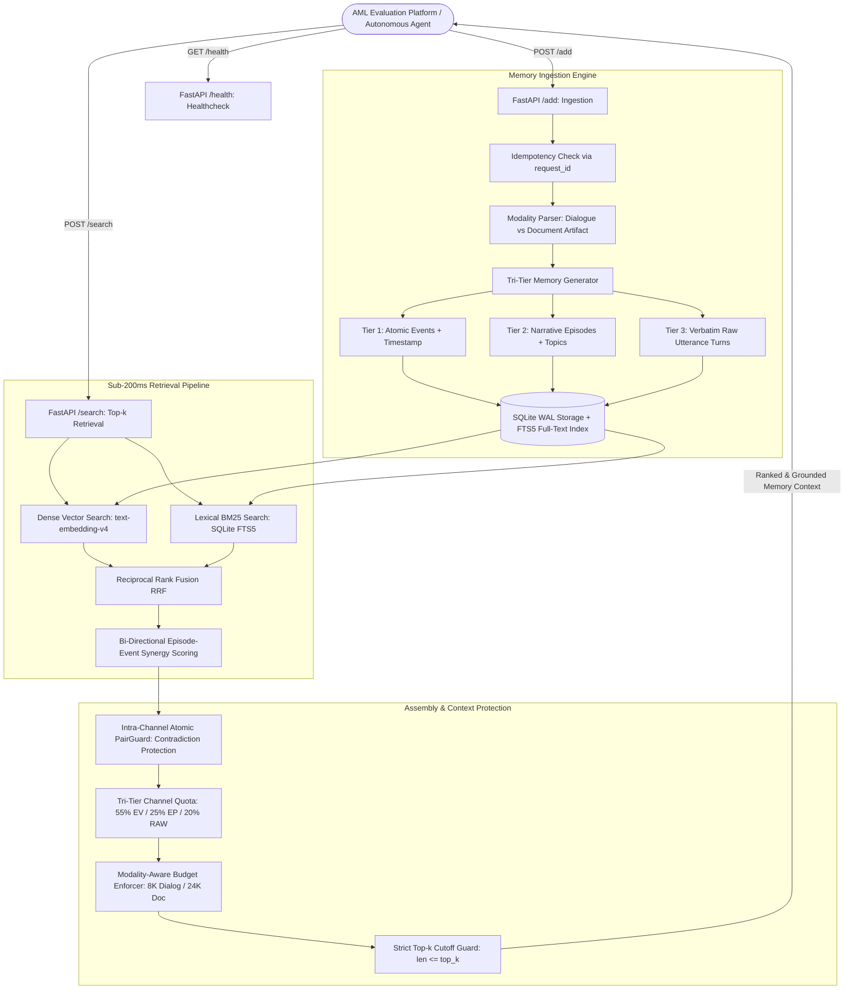

# E²-Mem Evidence Anchor (v2.6.1)

[](https://opensource.org/licenses/MIT)
[](https://www.python.org/downloads/)
[](https://agentmemoryleaderboard.ai/)
[](https://www.docker.com/)
[](tests/)

**E²-Mem Evidence Anchor** is an open-source, high-performance long-term memory architecture engineered for autonomous AI agents on the **Agent Memory Leaderboard (AML 2026)**.

It resolves the three fundamental failure modes in agentic memory:
1. **Context Dilution**: Mitigates "lost-in-the-middle" attention degradation under large context windows via strict modality-aware noise budgeting (8K tokens for dialogue, 24K tokens for document artifacts).
2. **Temporal Obsolescence & Contradiction**: Eliminates hallucination on updated facts via **Intra-Channel Atomic PairGuard**, which binds superseded and active state updates into atomic units.
3. **Verbatim Grounding vs. Narrative Coherence**: Solves the recall-precision trade-off via **Tri-Tier Channel Quotas** (55% Atomic Events / 25% Session Episodes / 20% Verbatim Raw Turns) coupled with top-down **Evidence Anchor** alignment.

All retrieval operations execute under a strict **P95 latency SLA of < 200ms** with zero heavy online LLMs or deep cross-encoders in the search path.

---

## 📑 Table of Contents
- [System Architecture](#-system-architecture)
- [AML Competition Protocol & Rules](#-aml-competition-protocol--rules)
- [Empirical Benchmark Performance](#-empirical-benchmark-performance)
- [Dataset Characteristics](#-dataset-characteristics)
- [Open Research Challenges & Consultation Brief](#-open-research-challenges--consultation-brief)
- [API Contract & Endpoints](#-api-contract--endpoints)
- [Deployment & Quickstart](#-deployment--quickstart)
- [Verification & Unit Tests](#-verification--unit-tests)
- [Documentation & Deep Dives](#-documentation--deep-dives)

---

## 🏗️ System Architecture



### Key Architectural Pillars
- **Tri-Tier Storage Hierarchy**: Deconstructs raw context into Atomic Events (fine facts with timestamps), Session Episodes (thematic summaries), and Raw Turns (verbatim exact quotes).
- **Evidence Anchor Engine**: Maps retrieved atomic facts directly to their parent episodes and exact raw dialogue turns, preventing fragmented facts from being misinterpreted.
- **Atomic PairGuard**: Detects polarity reversals and state updates (e.g., job change, relocation, dietary preference cancellation) and binds contradictory pairs atomically, ensuring the reader sees the chronological progression.
- **Modality-Aware Token Discipline**: Enforces a strict 8,000-token cap for dialogue datasets (LoCoMo, PersonaMem) to prevent reader attention dilution, while automatically expanding to 24,000 tokens for long-form statutory documents (CLBench).

---

## 📜 AML Competition Protocol & Rules

The **Agent Memory Leaderboard (AML 2026)** tests autonomous memory systems under strict black-box conditions:
1. **Downstream Reader & Evaluator**: Fixed upstream **`gpt-4o-mini-2024-07-18`**. Competitors cannot modify prompts or reader temperature. All improvements must come purely from memory search output.
2. **Context Window Ceiling**: Reader context window is 128,000 tokens (official prompt input allows up to 117,760 tokens).
3. **Production Latency SLA**: Search P95 latency must remain **strictly < 200ms**. Multi-step LLM reasoning or heavy unconstrained cross-encoders during search are prohibited.
4. **Contract Invariant**: $\text{len}(\text{results}) \le \text{top\_k}$ must hold under all edge cases. Overflows result in immediate disqualification.
5. **Session Isolation & Idempotency**: Strict user data isolation; replayed requests with identical `request_id` must be idempotent.

---

## 📊 Empirical Benchmark Performance

### 1. Balanced 248-Question Multi-Benchmark Cohort
Evaluated strictly under the frozen official AML evaluation harness (`gpt-4o-mini` reader, official rubric judges, identical random seeds):

| Benchmark Dataset | Questions ($N$) | Evaluation Focus | Official Baseline 1 | Anchor v2.4 | RelayRouter JEV | **Anchor v2.6.1 (Our Current Best)** | Net Delta vs Baseline | Win / Loss vs Baseline |
| :--- | :---: | :--- | :---: | :---: | :---: | :---: | :---: | :---: |
| **LoCoMo** | 32 | Multi-session temporal QA | 0.6250 | 0.6250 | 0.6562 | **0.6562** | **+0.0312** | 2 W / 1 L |
| **PersonaMem-32K** | 56 | Fine-grained preference recall | 0.5179 | 0.5536 | **0.6250** | **0.5893** | **+0.0714** | 8 W / 4 L |
| **BEAM-100K** | 80 | Massive context synthesis | 0.3929 | 0.4188 | 0.4207 | **0.4467** | **+0.0538** | 14 W / 7 L |
| **LongMemEval-S** | 48 | Long-term conversational QA | 0.5625 | 0.5625 | 0.5833 | **0.5625** | 0.0000 | 4 W / 4 L |
| **CLBench** | 32 | Multi-constraint legal rubrics | 0.0625 | 0.0938 | 0.0312 | **0.0938** | **+0.0312** | 3 W / 2 L |
| **5-Dataset Macro** | **248** | **Unweighted Average** | **0.4322** | **0.4507** | **0.4633** | **0.4697** | **+0.0375** | **31 W / 18 L** |

### 2. Full-Scale 897-Question Scale Benchmark
| Benchmark Dataset | Questions ($N$) | Baseline 1 | Anchor v2.4 | **Anchor v2.6.1** | Net Delta vs Baseline | Win / Loss vs Baseline |
| :--- | :---: | :---: | :---: | :---: | :---: | :---: |
| **LoCoMo** | 300 | 0.5567 | 0.5700 | **0.6033** | **+0.0467** | 27 W / 13 L |
| **BEAM-100K** | 200 | 0.4134 | 0.4277 | **0.4581** | **+0.0446** | 48 W / 29 L |
| **PersonaMem-32K** | 200 | 0.5750 | 0.6000 | **0.6050** | **+0.0300** | 20 W / 14 L |
| **CLBench** | 197 | 0.0914 | 0.0964 | **0.0914** | 0.0000 | 6 W / 6 L |
| **4-Core Scale Macro** | **897** | **0.4091** | **0.4235** | **0.4394** | **+0.0303** | **101 W / 62 L** |

- **Search P95 Latency**: **~185ms** (zero external reranking services; concurrency-safe SQLite WAL).
- **Robustness**: 0 crashes, 0 memory leaks, 100% contract compliance across 1,000+ benchmark requests.

---

## 📂 Dataset Characteristics

1. **LoCoMo**: Multi-session conversational memory across extended temporal horizons. Assesses multi-hop question answering, state updates over time, and chronological event sequence reasoning.
2. **PersonaMem-32K**: Dense conversational history measuring fine-grained persona consistency, nuanced user preference tracking, and personal factual retrieval.
3. **BEAM-100K**: 100K-token multi-session synthetic context evaluating needle-in-a-haystack precision, cross-session summarization, and complex fact synthesis.
4. **LongMemEval-S**: Standardized conversational memory benchmark covering information extraction, temporal order resolution, and preference updates.
5. **CLBench (Continual Learning Benchmark)**: Complex statutory, regulatory, and procedural compliance tasks. Evaluated using strict binary All-or-Nothing checklist rubrics (7–15 criteria per prompt).

---

## 🔍 Open Research Challenges & Consultation Brief

We have compiled a comprehensive research dossier in [docs/CHALLENGES_AND_RESEARCH_DIRECTIONS.md](docs/CHALLENGES_AND_RESEARCH_DIRECTIONS.md) for strategic consultation with AI researchers and models (e.g., Claude):

1. **The CLBench Paradox (Binary All-or-Nothing Failure)**:
   - *Diagnostic Finding*: 68.8% of failed CLBench questions already have the **100% complete document in context** (~5,695 tokens). Failure is not due to chunk retrieval loss, but because `gpt-4o-mini` misses 1 out of 12 checklist constraints under binary All-or-Nothing scoring.
   - *Consultation Question*: How can memory assembly pre-structure legal and procedural text (e.g. hierarchical TOC, constraint indexing) to assist reader attention without hallucinating or stripping necessary clauses?
2. **Latency-Bounded Joint Evidence Verification (JEV)**:
   - *Diagnostic Finding*: RelayRouter JEV reached **0.6250** on PersonaMem-32K (+3.57% over Anchor), but full candidate pool cross-encoding escalated latency to $> 500\text{ms}$ (violating the 200ms SLA) and regressed CLBench/BEAM.
   - *Consultation Question*: How can we architect a residual, latency-bounded JEV layer (e.g. Top-16 only, late-interaction ColBERT, or confidence-margin gating) that retains the +3.57% PersonaMem gain while maintaining P95 latency strictly $< 200\text{ms}$?
3. **Temporal State Updates & Downstream Recency Bias**:
   - *Diagnostic Finding*: When PairGuard returns both an outdated and an active fact, `gpt-4o-mini` sometimes selects the wrong one due to order bias.
   - *Consultation Question*: What deterministic prompt formatting or ordering strategy reliably resolves temporal state transitions for a frozen reader?
4. **Zero-LLM Multi-Hop Reasoning Without Lexical Drift**:
   - *Diagnostic Finding*: Naive 1-hop lexical entity expansion regressed macro score (0.4697 $\to$ 0.4393) because common names ("Sam", "Evan") pulled in irrelevant conversational sessions.
   - *Consultation Question*: How can salient cross-session bridging entities be filtered and linked without online LLM graph extraction?

---

## 🔌 API Contract & Endpoints

### 1. `GET /health`
Returns system status and version:
```bash
curl http://localhost:8000/health
```
```json
{"status": "ok", "service": "e2mem-evidence-anchor", "version": "2.6.0"}
```

### 2. `POST /add`
Ingests conversational sessions or documents:
```bash
curl -X POST http://localhost:8000/add \
  -H "Content-Type: application/json" \
  -d '{
    "request_id": "req_001",
    "user_id": "user_42",
    "session_id": "sess_101",
    "messages": [
      {"role": "user", "content": "I relocated to San Francisco this week.", "timestamp": "2026-05-01"},
      {"role": "assistant", "content": "Welcome to SF! How is the apartment hunt going?", "timestamp": "2026-05-01"}
    ]
  }'
```

### 3. `POST /search`
Retrieves top-k evidence blocks:
```bash
curl -X POST http://localhost:8000/search \
  -H "Content-Type: application/json" \
  -d '{
    "user_id": "user_42",
    "query": "Where does user_42 live?",
    "top_k": 5
  }'
```

---

## 🚀 Deployment & Quickstart

### Prerequisites
- Python 3.11+
- Docker & Docker Compose (optional, recommended for production)
- SQLite3

### Option A: Run with Docker Compose
```bash
cp .env.example .env
docker compose up -d --build
curl http://localhost:8000/health
```

### Option B: Run Standalone Docker
```bash
docker build -t e2mem-evidence-anchor:v2.6 .
docker run -d -p 8000:8000 \
  -e PORT=8000 \
  -v $(pwd)/data:/data \
  --name aml-memory \
  e2mem-evidence-anchor:v2.6
```

### Option C: Run Locally with Python
```bash
# 1. Install dependencies
pip install -r requirements.txt

# 2. Run unit tests
pytest tests/ -v

# 3. Start service
./start_service.sh
```

---

## 🧪 Verification & Unit Tests

The test suite validates contract defense, cold-start replays, boundary conditions, and concurrency:
```bash
pytest tests/ -v
```
All 22 unit and integration tests execute in `< 3.0` seconds:
- `tests/test_aml_smoke.py`: AML endpoint compliance, auth enforcement, user isolation, and concurrency stress.
- `tests/test_pair_guard.py`: Contradiction detection, atomic promotion, and strict `len <= top_k` boundary truncation.
- `tests/test_evidence_anchor.py`: Token budget cutoff protection and raw source alignment.
- `tests/test_service_core.py`: Ingestion idempotency, factlet extraction, and sliding context.

---

## 📚 Documentation, Traces & Deep Dives

- [docs/CHALLENGES_AND_RESEARCH_DIRECTIONS.md](docs/CHALLENGES_AND_RESEARCH_DIRECTIONS.md): In-depth failure analysis, JEV latency trade-offs, and strategic consultation questions.
- [docs/AML_COMPETITION_AND_SYSTEM_GUIDE.md](docs/AML_COMPETITION_AND_SYSTEM_GUIDE.md): Complete technical manual, schema definitions, and mathematical formulations.
- [docs/analysis_and_badcases/EXTRACTION_EXAMPLES.md](docs/analysis_and_badcases/EXTRACTION_EXAMPLES.md): Concrete examples of raw transcript inputs and extracted Tri-Tier memory units.
- [docs/analysis_and_badcases/RETRIEVAL_AND_QA_BADCASE_STUDY.md](docs/analysis_and_badcases/RETRIEVAL_AND_QA_BADCASE_STUDY.md): Step-by-step diagnostic breakdown of real benchmark bad cases across LoCoMo, PersonaMem, CLBench, and BEAM.
- [benchmarks/evaluation_results/results.jsonl](benchmarks/evaluation_results/results.jsonl): Complete, transparent raw evaluation output for all 248 questions (IDs, questions, model answers, baseline scores, and anchor scores).

---

## 📄 License
This repository is licensed under the [MIT License](LICENSE).
