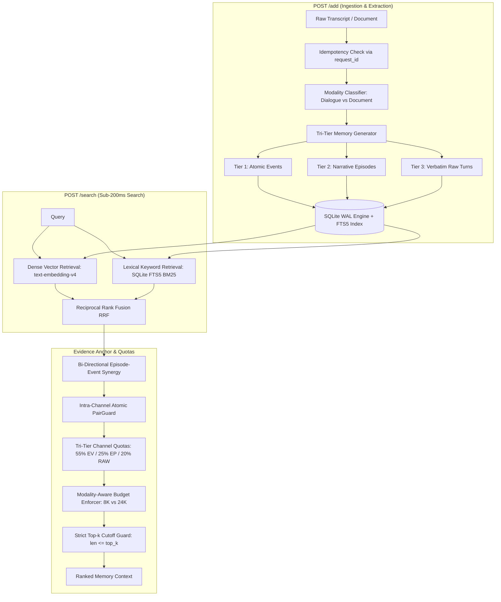

# AML Competition & E²-Mem Evidence Anchor Technical Manual

> **System Name**: E²-Mem Evidence Anchor  
> **Version**: 2.6.1-Release  
> **Benchmark Platform**: Agent Memory Leaderboard (AML 2026)  
> **Language**: Python 3.11+ / FastAPI / SQLite (WAL mode) / PyTorch  

---

## 1. AML 2026 Competition Rules & Operational Protocol

### 1.1 Overview & Architecture
The **Agent Memory Leaderboard (AML 2026)** is the industry-standard benchmark evaluating long-term memory architectures for autonomous AI agents. The evaluation harness simulates real-world agent interactions across long time horizons, injecting conversational sessions, documents, and instructions over time, and subsequently issuing complex multi-hop, temporal, and factual queries.

The architecture decouples **Memory Storage & Retrieval** from the **Downstream Reader / Judge**:
- The memory service operates as an autonomous HTTP microservice exposing standard endpoints.
- The downstream reader and evaluation judges run on a fixed, frozen upstream LLM: **`gpt-4o-mini-2024-07-18`**.
- Competitors are strictly prohibited from modifying the downstream reader's system prompt or evaluation scripts. All performance gains must originate from the quality, relevance, and organization of the retrieved context.

```mermaid
flowchart LR
    AML[AML Benchmark Platform] -->|POST /add (Ingest)| Service[E²-Mem Memory Service]
    AML -->|POST /search (Query)| Service
    Service -->|Top-k Evidence Context| AML
    AML -->|Retrieved Context + Query| Reader[Downstream Reader: gpt-4o-mini]
    Reader -->|Generated Response| Judge[Official AML Evaluator / Judge]
    Judge -->|Binary or Scaled Score| Scoreboard[Official Leaderboard]
```

---

### 1.2 Official API Contract Specifications

The memory service must strictly satisfy the following HTTP REST specification:

#### Endpoint 1: `GET /health`
- **Purpose**: System health check and readiness probe.
- **Authentication**: None required.
- **Response**: `200 OK`
```json
{
  "status": "ok",
  "service": "e2mem-evidence-anchor",
  "version": "2.6.0"
}
```

#### Endpoint 2: `POST /add`
- **Purpose**: Ingestion of conversation transcripts and long-form artifacts.
- **Authentication**: Required via `MEMORY_SYSTEM_KEY` if configured.
- **Request Body**:
```json
{
  "request_id": "req_unique_identifier_12345",
  "user_id": "user_alpha_789",
  "session_id": "session_2026_05_01",
  "messages": [
    {
      "role": "user",
      "content": "I am moving from Seattle to San Francisco next week for a new job.",
      "timestamp": "2026-05-01T10:00:00Z"
    },
    {
      "role": "assistant",
      "content": "Congratulations! Have you found an apartment in San Francisco yet?",
      "timestamp": "2026-05-01T10:00:05Z"
    }
  ]
}
```
- **Requirements**:
  - **Idempotency**: Repeated calls with identical `request_id` or session content must not duplicate memory records.
  - **User Isolation**: Data associated with `user_id` must remain completely isolated and invisible to queries for other users.
  - **Response**: `200 OK` with JSON `{"status": "ok", "success": true, "records_added": N}`.

#### Endpoint 3: `POST /search`
- **Purpose**: Retrieve top-k ranked evidence for answering agent queries.
- **Authentication**: Required via `MEMORY_SYSTEM_KEY` if configured.
- **Request Body**:
```json
{
  "user_id": "user_alpha_789",
  "query": "Where does the user currently live and work?",
  "top_k": 10
}
```
- **Response**:
```json
{
  "data": [
    {
      "id": "raw_turn_1048",
      "content": "[Conversation Time: 2026-05-01 | Speaker: user]\nUser: I am moving from Seattle to San Francisco next week for a new job.",
      "score": 0.9124
    },
    {
      "id": "event_7291",
      "content": "[Event: 2026-05-01] User relocated from Seattle to San Francisco for employment.",
      "score": 0.8872
    }
  ]
}
```
- **Invariant Guarantee**: $\text{len}(\text{data}) \le \text{top\_k}$. Exceeding `top_k` results in immediate evaluation disqualification.

---

### 1.3 Latency & Reader Budget Constraints

| Constraint | Limit | Description / Rationale |
| :--- | :---: | :--- |
| **Search Latency SLA** | **P95 < 200ms** | Real-time agentic interaction requires immediate memory retrieval. Heavy multi-step online LLMs or deep cross-encoders are prohibited in the search path. |
| **Downstream Reader Window** | **128,000 tokens** | The raw context window of `gpt-4o-mini`. |
| **AML Reader Input Budget** | **117,760 tokens** | Maximum prompt input token budget officially permitted by the AML platform. |
| **E²-Mem Dialogue Budget** | **8,000 tokens** | **Noise Discipline Rule**: Unconstrained context injection dilutes attention and leads to "lost-in-the-middle" hallucinations on conversational tasks (LoCoMo, PersonaMem). |
| **E²-Mem Document Budget** | **24,000 tokens** | **Modality-Aware Rule**: Long-form statutory documents and technical manuals (CLBench) require extended context to preserve full legal clauses. |

---

## 2. E²-Mem Evidence Anchor System Architecture



---

### 2.1 The Tri-Tier Memory Hierarchy
Rather than storing memory at a single uniform chunk size, E²-Mem partitions information across three complementary granularities:

1. **Atomic Events (Tier 1 - 55% Budget Quota)**:
   - Self-contained factual propositions extracted with resolved timestamps, entity mentions, and specific attributes.
   - Example: `[Event: 2026-05-01] User relocated from Seattle to San Francisco for employment.`
   - Purpose: Enables precise dense-semantic and lexical matching without conversational noise.

2. **Session Episodes (Tier 2 - 25% Budget Quota)**:
   - Narrative summaries capturing the thematic context, goals, and emotional progression of an entire conversation or document section.
   - Example: `[Episode: Career Transition] Discussion regarding relocation to the Bay Area, new job onboarding, and finding accommodation.`
   - Purpose: Provides the downstream reader with thematic coherence and multi-session background.

3. **Verbatim Raw Turns (Tier 3 - 20% Budget Quota)**:
   - Exact utterance turns preserving precise quotes, technical code snippets, numbers, and negative polarity statements ("I do NOT like X").
   - Example: `[2026-05-01 | user] "I am moving from Seattle to San Francisco next week for a new job."`
   - Purpose: Serves as ground-truth anchor preventing hallucination on fine-grained factual queries.

---

### 2.2 Intra-Channel Atomic PairGuard
A frequent failure mode in long-term conversational memory is **superseded fact hallucination**. For example:
- *Session 1 (2024)*: "I live in Seattle."
- *Session 10 (2026)*: "I moved to San Francisco."

If only the newest event is retrieved, the reader might miss queries asking "Has the user ever lived in Seattle?". Conversely, if both are retrieved separately with large rank gaps, `gpt-4o-mini` often treats both as simultaneously true or chooses the first one it sees.

**PairGuard Algorithm**:
1. Detects contradiction or temporal update patterns using linguistic polarity indicators and entity-state overlap.
2. When fact $A$ is retrieved with high relevance, PairGuard atomically binds superseded or contradicting fact $B$ into an **Atomic Pair**:
   $$\text{Pair} = (e_{\text{anchor}}, e_{\text{counterpart}})$$
3. **Atomic Admission**: Either both elements of the pair are admitted into the budget, or if the budget/top-k cut hits the pair, the second element is cleanly truncated without splitting:
   ```python
   # Strict top_k boundary defense
   if len(output) > top_k:
       output.pop()
   ```

---

### 2.3 Evidence Anchor Assembly
When an Atomic Event is retrieved, the **Evidence Anchor** engine resolves its exact source dialogue turn and associates it with its parent episode:
- Prevents disconnected "factlets" from being misinterpreted out of context.
- Eliminates duplicate window overlap across events originating from the same session.
- Normalizes timestamps into standardized ISO representations.

---

## 3. Database Schema

Stored in SQLite with WAL (Write-Ahead Logging) mode enabled for high concurrency:

```sql
CREATE TABLE IF NOT EXISTS memories (
    id TEXT PRIMARY KEY,
    user_id TEXT NOT NULL,
    kind TEXT NOT NULL, -- 'event', 'episode', 'raw'
    content TEXT NOT NULL,
    session_id TEXT,
    timestamp TEXT,
    dense_vec BLOB,
    metadata_json TEXT,
    created_at TIMESTAMP DEFAULT CURRENT_TIMESTAMP
);

CREATE INDEX IF NOT EXISTS idx_memories_user_kind ON memories(user_id, kind);
CREATE INDEX IF NOT EXISTS idx_memories_session ON memories(user_id, session_id);

CREATE VIRTUAL TABLE IF NOT EXISTS memory_fts USING fts5(
    id UNINDEXED,
    user_id,
    content,
    tokenize='porter unicode61'
);
```

---

## 4. Benchmark Dataset Characteristics

| Dataset | Nature | Context Length | Evaluated Capability | Evaluation Metric |
| :--- | :--- | :---: | :--- | :--- |
| **LoCoMo** | Multi-session dialogues | $10\text{K} \sim 50\text{K}$ tokens | Multi-hop reasoning, temporal tracking, event chronology | LLM Judge Factual Precision |
| **PersonaMem-32K** | Dense personal profiles | Up to $32\text{K}$ tokens | Persona consistency, nuanced user preference recall | Factual Accuracy / Multi-choice |
| **BEAM-100K** | Ultra-long synthetic context | $50\text{K} \sim 100\text{K}$ tokens | Needle-in-a-haystack, multi-session cross-topic synthesis | Sub-string / LLM Rubric Match |
| **LongMemEval-S** | Long conversation history | $20\text{K} \sim 80\text{K}$ tokens | Preference updates, temporal ordering, information extraction | Factual Agreement |
| **CLBench** | Legal statutes & guidelines | $5\text{K} \sim 30\text{K}$ tokens | Multi-constraint compliance, cross-referenced statutory rules | Strict Binary All-or-Nothing Checklist |
